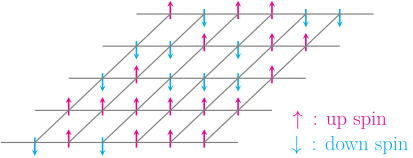

{.project-hero fig-alt="Diagram of a 2D Ising model: a square lattice with a spin at every site, drawn as an arrow pointing up or down."}

::: {.project-hero-credit .small .text-muted}
Image: [“2D ising model on lattice”](https://commons.wikimedia.org/wiki/File:2D_ising_model_on_lattice.svg) by Ta2o, [CC BY 4.0](https://creativecommons.org/licenses/by/4.0/), via Wikimedia Commons.
:::

::: {#project-posts}
:::
